# Bookorig

A PDF book reader for your phone. You get one page at a time, no scrolling, and the page curls over when you turn it.

It runs in the browser and installs like an app. Your books stay on your phone and never get uploaded anywhere.

Open it at https://hirokadhikari.github.io/bookorig/

<table>
  <tr>
    <td align="center">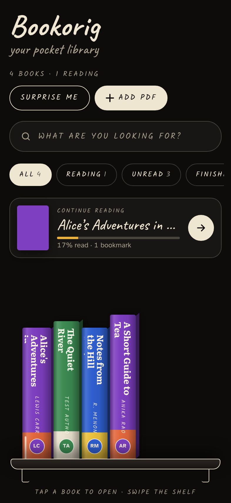<br>The shelf</td>
    <td align="center">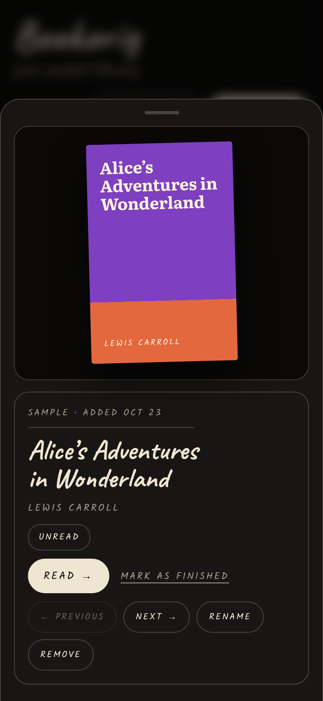<br>Book card</td>
    <td align="center">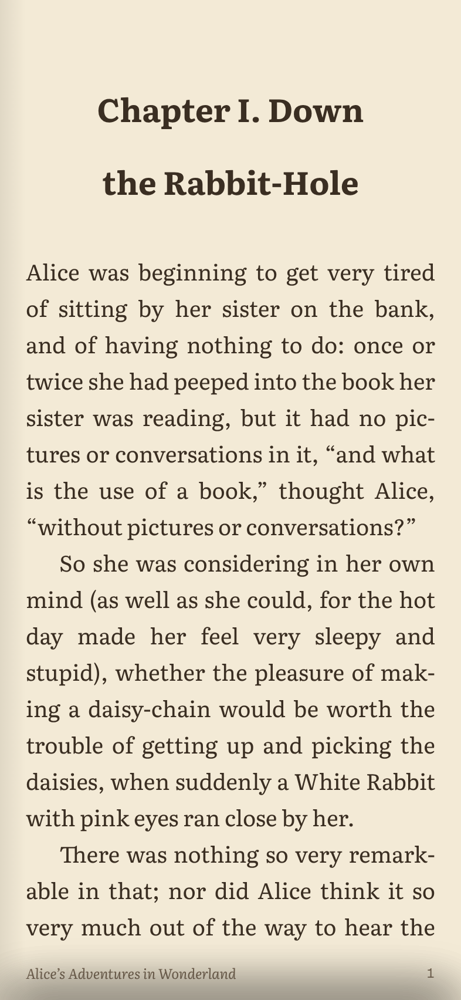<br>Reading</td>
    <td align="center">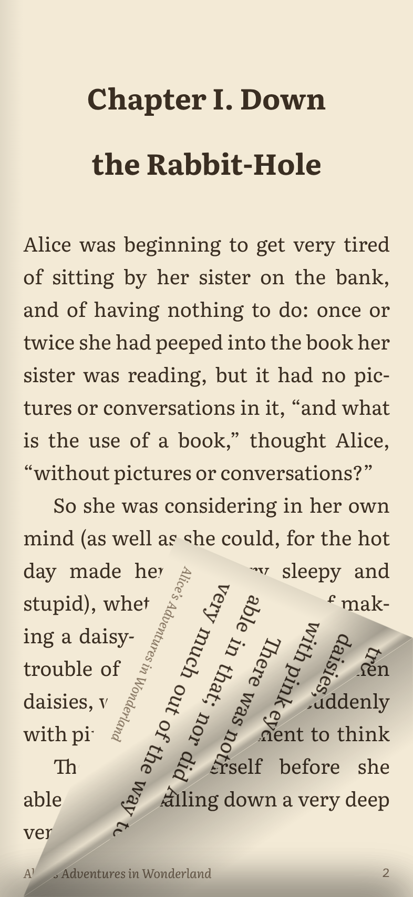<br>Page curl</td>
  </tr>
  <tr>
    <td align="center">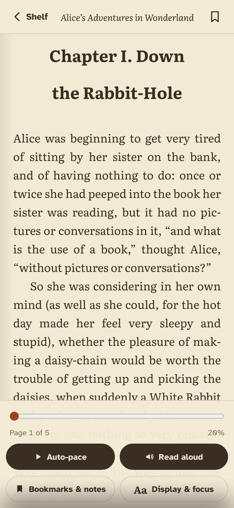<br>Menu</td>
    <td align="center">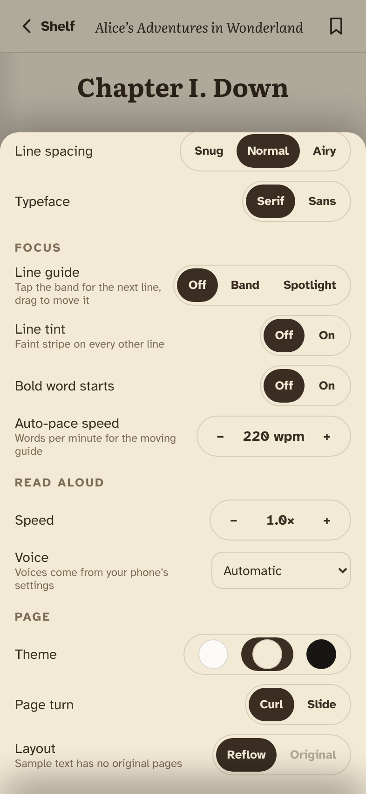<br>Display &amp; focus</td>
    <td align="center">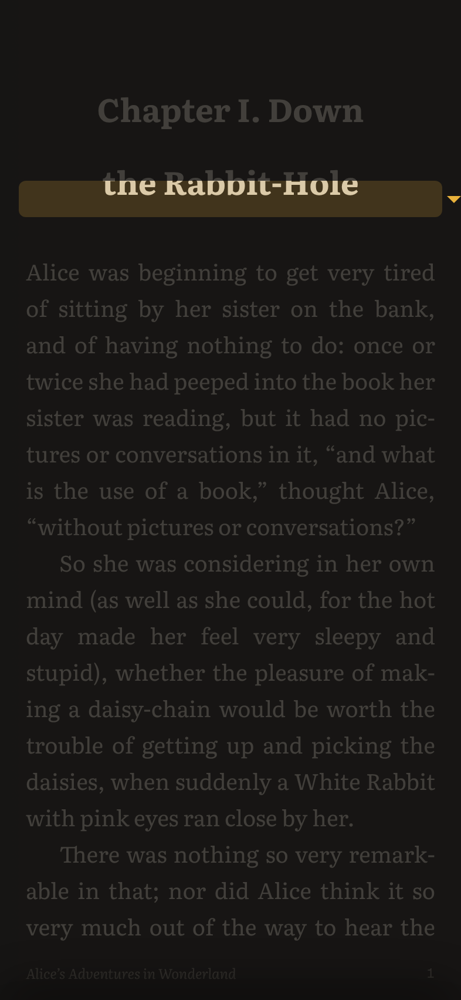<br>Spotlight line guide</td>
    <td align="center">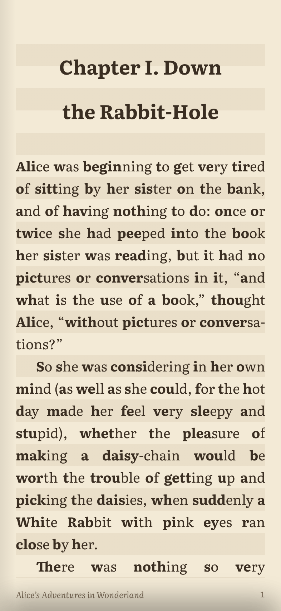<br>Line tint and bold starts</td>
  </tr>
  <tr>
    <td align="center">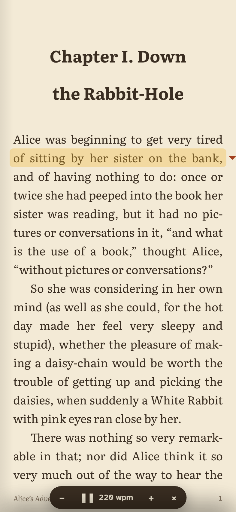<br>Auto-pace</td>
    <td align="center">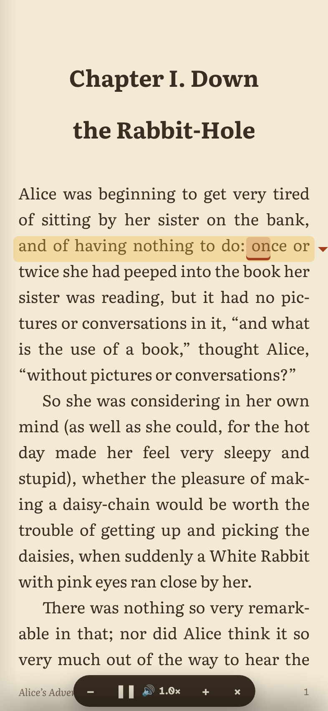<br>Read aloud</td>
    <td align="center">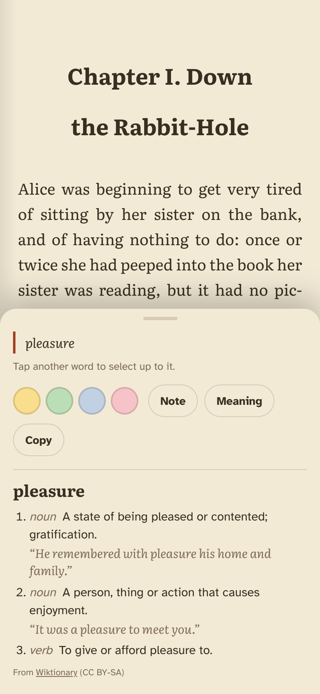<br>Long-press for meaning</td>
    <td align="center">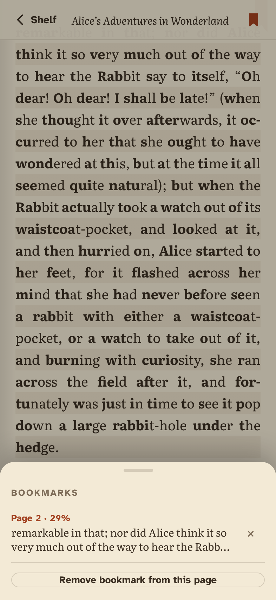<br>Bookmarks &amp; notes</td>
  </tr>
</table>

## Getting it on your phone

1. Open the link in Chrome on Android.
2. Tap Install on the shelf, or Chrome menu ⋮ > Add to Home screen.
3. Tap + Add PDF. Later you can also share a PDF to Bookorig straight from Files or WhatsApp.

Once it's installed it works offline.

## For eyes that wander off the line

If you lose your place mid-paragraph (ADHD or just a long day), these are the settings to try. They live under Display & focus, which you reach by tapping the middle of the page.

- Line guide puts a highlighted band on one line. Tap the band to move down a line. At the bottom of the page it turns the page for you and starts again at the top. Drag it to jump anywhere.
- Spotlight is the same band, but every other line fades back so only one line is really there.
- Line tint adds a faint stripe behind every other line, which makes it harder to drop onto the wrong one.
- Bold word starts bolds the first part of each word. Some people find it easier to follow and some can't stand it, so it's off by default.
- Line spacing has snug, normal and airy.
- Auto-pace moves the guide down the page by itself at a speed you pick in words per minute, and turns the page when it reaches the bottom. Tap the band to pause.
- Read aloud uses your phone's voices. The guide follows along and the word being spoken is underlined, so your eyes and ears stay on the same line.
- There's no scrolling anywhere. A page fills the screen and stays put until you turn it.
- Bookmarks are one tap on the ribbon. They point at the passage rather than a page number, so they still land in the right spot after you change the font size.
- Every book reopens exactly where you stopped.

## Meanings, highlights and notes

Long-press any word. You get its meaning (this part needs internet), plus four highlight colours, a note box and copy. Drag after the long-press, or tap another word, to select more than one word. Everything you mark shows up under Bookmarks & notes, where you can jump to it or copy it all out. Highlights stick to the words, not the page, so they stay put when you change the text size.

## Reading

Swipe, drag a corner, or tap the left or right edge to turn. Tap the middle for the menu and the page slider.

PDFs with real text get reflowed to fit your screen and font size. Scanned PDFs open as the original pages. For books that have text you can switch between the two whenever you like.

There are light, sepia and dark themes, serif or sans text, and a plain slide instead of the curl if your phone struggles with the animation.

## Things to know

Books are saved in Chrome's storage on that phone. They don't sync between devices, and clearing site data for this site deletes them, so keep the PDFs somewhere else as well.

Scanned books come with text from the scanner's OCR, and that text can be rough. Bookorig cleans it up carefully. A word that is already a real English word is never changed, however rare or advanced it is. Only tokens that aren't words at all get repaired, and only when there is exactly one sensible fix: look-alike letters ("1esson" becomes "lesson", "rnove" becomes "move"), words broken by stray spaces ("Ack nowledgmen ts" becomes "Acknowledgments"), spaced-out headings and junk symbols. Names the book uses again and again are left alone. Pages that are still mostly unreadable appear as the original scan, and the page icon at the top shows the scan of any page so you can check it against the text.

Sharing a PDF to Bookorig needs Android and the installed app.

On Android with gesture navigation, swiping in from a screen edge is the system Back gesture. Bookorig catches it, so one stray swipe never closes your book. Swipe back twice quickly to leave.

## Running it yourself

It's plain static files with no build step.

```
python -m http.server 8000
```

Then open http://localhost:8000/. If you change anything, bump `VERSION` in `sw.js` so installed copies pick up the new files.

## Credits

PDF reading by [pdf.js](https://github.com/mozilla/pdf.js) and the page curl by [StPageFlip](https://github.com/Nodlik/StPageFlip). Word meanings come from [Wiktionary](https://en.wiktionary.org/) (CC BY-SA). The English word list used for OCR repair is from [word-list](https://github.com/sindresorhus/word-list) (MIT). Fonts are Literata, Atkinson Hyperlegible, Caveat and Kalam. The sample book is the first chapter of Alice's Adventures in Wonderland (1865, public domain). Licenses are in `vendor/LICENSES.txt`.
